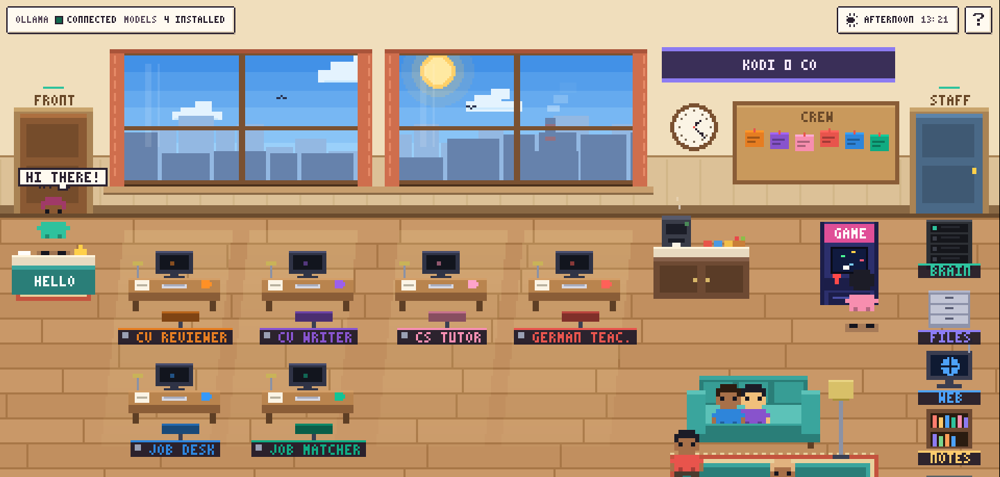

# AgentFactory

Local AI agents that live in a small pixel-art office on your Mac. Every agent runs on your own computer through
[Ollama](https://ollama.com): no cloud model, no API key, your files stay on your disk.



Click a desk to chat with that agent. Agents walk to the tool stations on the right (files, web, notes, build
machine, flashcards) when they use a tool. **Hire** creates a new agent through a short interview; **Staff** shows
each agent's settings, notes and flashcards.

## The agents

| Agent | What it does |
|---|---|
| **German Teacher** | Short lessons by level (A0-B1), corrects every mistake, and keeps flashcards with spaced repetition. |
| **CS Tutor** | Explains computer science and checks C++ code by compiling and running it. |
| **Job Desk** | Runs the job search: reads your CV and GitHub, searches LinkedIn, shortlists, makes the PDFs. |
| **Job Matcher** | Goes through the internships with you and ranks them against your profile. |
| **CV Writer** | Writes a CV and cover letter for one job, in your master CV's design, using only your real facts. |
| **CV Reviewer** | Checks every claim in a draft against your facts before it becomes a PDF. |

Each agent is one YAML file in `specs/` (its instructions, model, tools and permissions). An agent can only use the
tools and folders its file allows, and it can never replace an existing file unless allowed.

## Automatic job search

Every 3 hours the four job agents run on their own, with one trigger:

1. **Job Desk** searches LinkedIn for AI, ML and data-engineering internships anywhere in Germany, in English and
   German (the last 24 hours on the first run of a day, then since the last run; jobs already seen are skipped).
2. **Job Matcher** ranks each new internship against your CV: requirements, the facts that show them, gaps, fit 0-100.
   Jobs that are not AI/ML/data internships are hidden.
3. **CV Writer** makes a tailored CV (your 3 most relevant projects) and cover letter for the best matches.
4. **CV Reviewer** checks every number and claim against your CV; anything unsupported is fixed or removed.

You get a Mac notification, a report in `output/runs/`, all ranked internships in `output/ranked_jobs.md`, and the
PDFs in `output/`. **Nothing is ever sent**: you read and approve every document and apply yourself.
Start it any time with "run now" in Job Desk. Details: [docs/JOB-AGENTS.md](docs/JOB-AGENTS.md).

> Automated access to LinkedIn conflicts with LinkedIn's User Agreement. The search is for low-volume personal use:
> 3-5 seconds between requests, at most 30 requests per run, and it stops when LinkedIn refuses.

## Setup

Tested on a MacBook Air M4 with 16 GB of memory.

```bash
# 1. Ollama and the model (about 5 GB)
brew install ollama
brew services start ollama
ollama pull qwen3:8b

# 2. Python environment
python3 -m venv .venv
.venv/bin/pip install fastapi uvicorn httpx pydantic pyyaml pypdf pytest

# 3. Start
.venv/bin/python serve.py          # opens http://127.0.0.1:8010
```

The commands call `.venv/bin/python` directly, so you never have to activate the venv. To type plain `python`
instead, run `source .venv/bin/activate` (not `.venv/bin/activate` on its own, which fails with "permission denied").
VS Code activates it in new terminals through `.vscode/settings.json`.

For the job agents also:
- put your CV at `inputs/master_cv.pdf`;
- install Google Chrome (it prints the CV and letter PDFs);
- turn on the automatic search with Job Desk ("turn on the automatic search every 3 hours"), or:
  `.venv/bin/python scripts/jobs/schedule.py '{"action": "install", "every_hours": 3}'`

`settings.yaml` sets the default model, how many agents may think at once (2 on 16 GB), and how long Ollama keeps
the model loaded. Keep Low Power Mode off while agents work; it makes them about 3 times slower.

## Tests

```bash
.venv/bin/python -m pytest
```

The tests run offline with a scripted model: no Ollama, network or Chrome needed.

## Project layout

```
factory/        the runtime: agent specs, model client, tools and permissions, web server
static/         the office in the browser (plain HTML, CSS and JavaScript)
specs/          one YAML file per agent
scripts/jobs/   the job-search programs and the automatic run (pipeline.py)
templates/      the CV and cover-letter design (HTML, CSS, Carlito font)
docs/           guides: JOB-AGENTS.md, PERFORMANCE.md
tests/          pytest suite
```

## Privacy

Your CV, profile, job postings, drafts and PDFs live in `inputs/`, `data/` and `output/`, which are not tracked by
git. The only network access is Ollama on your own computer, plus LinkedIn and GitHub for the job search.
